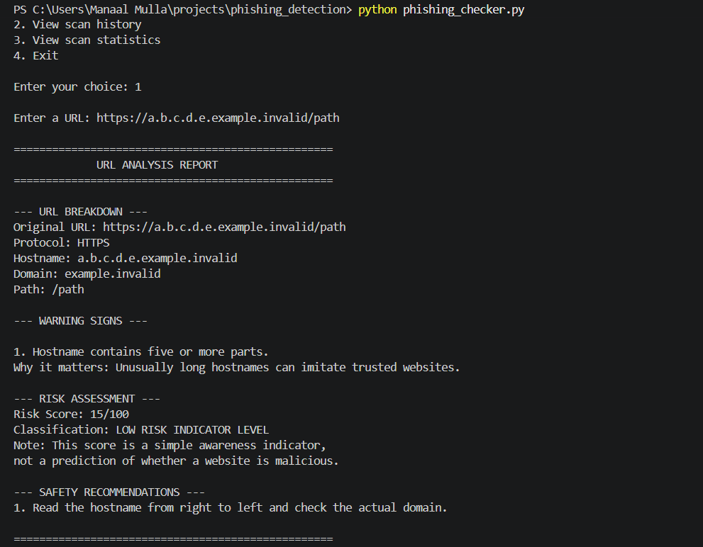
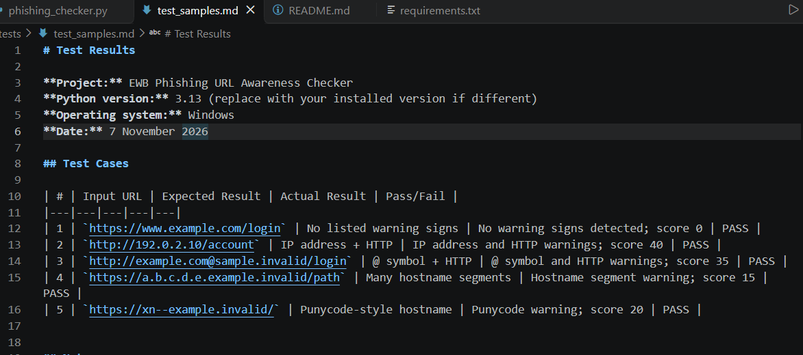

# EWB Phishing URL Awareness Checker

## Overview

Phishing is a type of cyberattack in which attackers use fake links or messages to trick people into sharing sensitive information such as passwords, banking details or OTPs.

The EWB Phishing URL Awareness Checker is a Python command-line program that examines URL text and identifies selected warning signs that may be associated with phishing. It provides explanations and safety recommendations to help users understand suspicious URL patterns.

The program only analyses the text entered by the user. It does not open websites or connect to the internet.

## Features

### Required URL checks

The program checks for six warning signs:

1. Presence of the `@` symbol.
2. URL length greater than 100 characters.
3. IP address used instead of a domain name.
4. Five or more hostname segments.
5. Punycode marker (`xn--`) in the hostname.
6. Use of HTTP instead of HTTPS.

### Additional features

- Detailed URL breakdown showing protocol, hostname, domain and path.
- Risk indicator score based on detected warning signs.
- Risk indicator classification.
- Explanations for detected warning signs.
- Safety recommendations based on the findings.
- Scan history for the current program session.
- Scan statistics showing total scans and warning results.
- Menu-based interface with an option to exit.

## Technologies Used

- Python 3
- Visual Studio Code
- Python standard libraries: `urllib.parse` and `ipaddress`

No third-party packages or API keys are required.

## Requirements

- Python 3.10 or later.
- Visual Studio Code or another Python editor.

## How to Run

1. Download or clone this repository.
2. Open the project folder in Visual Studio Code.
3. Open the terminal.
4. Run:

```bash
python phishing_checker.py
```

On some systems, use:

```bash
python3 phishing_checker.py
```

5. Select an option from the menu and enter a sample URL.

## Example Output

For the input:

```text
https://www.example.com/login
```

The program identifies the URL components and reports that no selected warning signs were detected.

The risk indicator score is 0.

**Important:** This does not prove that the URL is safe.

## Testing

Five sample URL test cases were executed. They cover:

- A URL with no selected warning signs.
- An IP address hostname and HTTP.
- An `@` symbol and HTTP.
- A hostname with many segments.
- A punycode-style hostname.

The detailed test results are available in [`tests/test_samples.md`](tests/test_samples.md).

## Screenshots

### Sample Program Run



### Test Results



## Improvements

1. **Repeated URL checking:** Added a loop and menu so users can analyse multiple URLs without restarting the program.
2. **Warning explanations:** Added explanations and safety recommendations to help users understand why a detected URL pattern may be suspicious.
3. **Detailed URL breakdown:** Added information about the protocol, hostname, domain and path.
4. **Risk indicator score:** Added a simple scoring system to summarise the number and type of warning signs.
5. **Scan history and statistics:** Added session-based history and statistics to review previous analyses.

## Limitations

- The program checks only six selected URL warning signs.
- It does not visit websites or perform live security scans.
- It does not check malware, domain reputation or website ownership.
- The risk score is a simple educational indicator, not a real phishing probability.
- A URL with no detected warning signs is not necessarily safe.
- HTTPS does not guarantee that a website is trustworthy.

## Ethical Use

This project is intended for defensive cybersecurity learning and awareness.

Use sample URL strings for testing. Do not collect credentials, send phishing messages or probe websites without permission.

## Author

Manaal Mulla 
EWB Courses  
Cybersecurity Mini Project